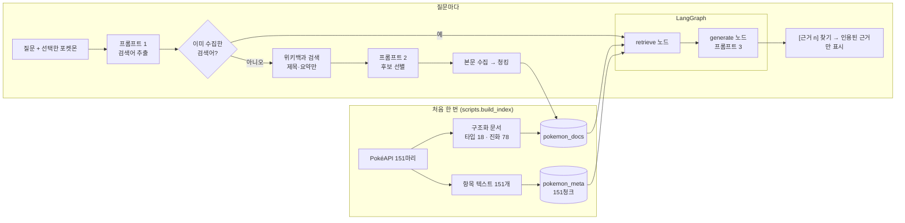

# RAG 파이프라인 설계문서 — 오박사의 연구노트

## 1. 전체 흐름



수집 단계는 LangGraph **바깥**에서 먼저 실행합니다. 그래프는 명세 F2007대로 `retrieve`와 `generate` 두 노드만 갖습니다(`python -m rag.graph --draw`로 확인).

## 2. Vector DB 컬렉션 구조 (F2002, F2005)

컬렉션을 둘로 나눈 이유: "선택한 포켓몬의 기본 정보는 **항상** 넣고, 외부 문서는 **검색으로** 고른다"는 규칙을 지키려면 둘을 따로 꺼낼 수 있어야 합니다. 한 컬렉션에 섞으면 메타데이터가 검색 순위에 밀려 빠질 수 있습니다.

| 컬렉션 | 내용 | 청크 단위 | 청크 ID 규칙 | 건수 |
|---|---|---|---|---|
| `pokemon_meta` | 항목 텍스트 | 포켓몬 1마리 = 1청크 (자르지 않음) | `pkm:{도감번호}` 예: `pkm:6` | 151 고정 |
| `pokemon_docs` | 위키백과 본문 + 구조화 문서 | 위키: 설정값으로 자름 / 구조화: 1청크 | `{포켓몬ID 또는 shared}:{문서ID}:{순번}` 예: `133:2514891:0`, `shared:type-ghost:0` | 질문할수록 늘어남 (처음 96) |

- 청크 ID를 고정하고 **upsert**(있으면 덮어쓰기, 없으면 추가)로 넣기 때문에 색인을 두 번 돌려도 건수가 늘지 않습니다.
- 같은 위키 문서를 여러 포켓몬이 수집해도 ID 앞부분(포켓몬ID)이 달라 서로 덮어쓰지 않습니다.
- 같은 문서를 다시 색인할 때는 그 포켓몬·문서의 예전 청크를 먼저 지워서, 청크 크기를 줄였을 때 옛 청크가 남지 않게 합니다.

### 메타데이터 필드

`pokemon_meta`

| 필드 | 예 | 쓰임 |
|---|---|---|
| `pokemon_id` | 6 | 선택한 포켓몬 바로 꺼내기 |
| `name_ko`, `dex_no` | 리자몽, 006 | 근거 제목 표시 |
| `types` | "불꽃,비행" | 표시용 (Chroma 메타데이터는 목록 대신 글자) |
| `type_1`, `type_2` | 불꽃, 비행 | 조건 탐색 타입 필터 |
| `is_legendary`, `is_mythical` | false | "전설의/환상의" 조건 |
| `weight_kg`, `height_m` | 90.5, 1.7 | 숫자 조건 ("100kg 넘는") |
| `source_type` | meta | 출처 종류 도장 |
| `source_title`, `source_url` | 리자몽 · PokéAPI 도감, species 주소 | 근거 목록 제목·원문 링크 |

`pokemon_docs`

| 필드 | 예 | 쓰임 |
|---|---|---|
| `pokemon_id` | 6 (공용 문서는 0) | **검색 범위 필터.** 빠지면 다른 포켓몬 문서가 근거에 섞임 |
| `related_names` | 리자몽 | 근거 목록의 관련 포켓몬 |
| `doc_id` | 위키 pageid 또는 `type-ghost` | 문서 단위 관리·재색인 |
| `source_type` | wikipedia / pokeapi | 출처 종류 도장 (F2016) |
| `source_title`, `source_url` | 문서 제목, `https://ko.wikipedia.org/?curid=…` | 근거 목록 제목·원문 링크 |
| `query` | 수집에 쓴 검색어 | 수집 캐시 확인, 디버깅 |
| `collected_at` | 2026-10-21 | 수집일 기록 (NF2007) |
| `chunk_index` | 0, 1, 2 … | 순번 |

### 검색 범위 규칙

외부 문서 검색 필터는 `{"$or": [{"pokemon_id": 선택한ID}, {"pokemon_id": 0}]}`입니다. 피카츄를 선택했을 때 리자몽 위키 문서가 섞이지 않고, 타입 상성·진화 같은 공용 문서는 어느 포켓몬에서나 쓸 수 있습니다.

## 3. 항목 텍스트 설계 (F2001)

사용자는 이름뿐 아니라 "불꽃 타입", "날개 달린", "무거운", "전설의" 같은 말로 포켓몬을 찾습니다. 빠진 속성으로는 검색이 걸리지 않으므로 모든 속성을 한 글로 묶었습니다. 도감 설명을 넣었기 때문에 생김새·습성으로 찾는 조건 검색이 가능합니다.

```
[포켓몬] 리자몽 (전국도감 006번, 영문 charizard)
분류: 화염포켓몬
타입: 불꽃, 비행
특성: 맹화, 선파워(숨겨진 특성)
키 1.7m, 몸무게 90.5kg
능력치: HP 78 / 공격 84 / 방어 78 / 특수공격 109 / 특수방어 85 / 스피드 100 (합계 534)
진화: 파이리 → (레벨 16) 리자드 → (레벨 36) 리자몽
구분: 일반 포켓몬
도감 설명: 지상 1400m까지 날개를 사용해 날 수 있다. 고열의 불꽃을 내뿜는다. (실드)
```

- 단위 변환: PokéAPI 키는 데시미터, 몸무게는 헥토그램이라 ÷10 합니다. 잊으면 Q6(잠만보 460kg) 답이 10배로 틀립니다.
- 세대에 따라 타입이 바뀐 포켓몬은 "예전 타입" 줄을 붙입니다. 예: 삐삐 "5세대까지는 노말 타입이었다", 코일 "1세대는 전기 타입이었다".
- 한국어 도감 설명은 가장 최근 버전 1개만 쓰고 버전 이름을 함께 적습니다(151마리 모두 한국어 설명 있음).

## 4. 문서 수집·청킹·색인 흐름 (F2003 ~ F2005)

1. **검색어 추출 (프롬프트 1)** — 결과와 상관없이 포켓몬 이름을 맨 앞에 강제로 넣고, 최대 `max_queries`(4)개까지 씁니다.
2. **수집 캐시 확인** — `포켓몬ID|검색어`가 `cache/collected_queries.json`에 있으면 건너뜁니다(NF2002). 모두 있으면 "예전에 모아 둔 자료를 다시 펼쳤어요".
3. **포켓몬 자체 문서 찾기** — `"{이름} (포켓몬)"`과 `"{이름}"` 제목을 한 번에 조회합니다.
   - 동음이의어 문서("팬텀")면 "팬텀 (포켓몬)"을 씁니다.
   - 표로만 된 "1세대 포켓몬 목록"으로 넘어가는 경우("꼬렛")는 단독 문서가 없는 것으로 보고 수집 결과에 이유를 남깁니다. 이때는 도감 데이터와 구조화 문서로 답합니다.
   - 151마리 조사 결과(`python -m scripts.survey_wiki` → `docs/wiki_coverage.md`): **단독 문서가 있는 포켓몬은 32마리**, 나머지 119마리는 목록 문서로만 연결됩니다. 그래서 도감 데이터와 구조화 문서를 처음부터 색인해 두는 설계가 중요합니다. 위키백과는 "포켓몬의 진화"처럼 검색어로 찾은 일반 개념 문서로 보충합니다.
4. **후보 모으기** — 검색어마다 위키 검색으로 `candidates_per_query`(5)개. 이때는 **제목과 짧은 요약(300자)만** 받습니다.
5. **후보 선별 (프롬프트 2)** — 번호만 받습니다. 선별을 본문 수집 앞에 둔 이유는 버릴 문서의 본문을 받지 않아 외부 호출 수를 줄이기 위해서입니다.
6. **포켓몬 자체 문서는 선별·최소 길이(200자) 규칙보다 우선해 항상 포함**합니다(F2004).
7. **본문 수집** — `prop=extracts&explaintext=1`. "같이 보기 / 각주 / 외부 링크 / 참고 자료" 이후는 버리고 빈 줄을 하나로 줄입니다. 원본은 `cache/wiki/<pageid>.json`.
8. **청킹 → 색인** — `RecursiveCharacterTextSplitter(chunk_size=800, chunk_overlap=150, separators=["\n\n", "\n", ". ", " "])`. 청크 앞에 `[문서: 제목]` 한 줄을 붙여, 잘린 청크만 봐도 어느 문서인지 알 수 있게 했습니다.
9. 실패 처리: 응답 오류·시간 초과는 1초·2초·4초 기다리며 최대 3번 다시 시도하고, 끝까지 실패하면 그 문서만 "가져오지 못함"으로 남기고 계속합니다.

### 출처 종류에 따라 청킹을 달리한 이유 (F2016)

| 출처 | 형태 | 청킹 | 이유 |
|---|---|---|---|
| 위키백과 | 긴 서술형 (수천~수만 자) | 800자 / 중복 150자 | 문단 단위로 잘라야 질문과 가까운 부분만 근거로 쓸 수 있음 |
| PokéAPI 구조화 문서 | 짧은 표를 문장으로 바꾼 글 (타입 1개·계통 1개) | 자르지 않고 1청크 | 타입 상성은 "공격/방어/1세대 차이"가 한 덩어리여야 의미가 맞음. 자르면 "1세대에서는…" 문장만 따로 떨어져 엉뚱한 타입으로 읽힐 수 있음 |
| PokéAPI 메타데이터 | 포켓몬 1마리 요약 | 1청크 | 항상 통째로 넣는 근거 1번 |

구조화 문서는 질문마다 수집하지 않고 처음 색인할 때 한 번에 넣습니다. LLM은 표보다 문장을 더 정확히 읽기 때문에 문장으로 바꿨습니다.

## 5. 검색 결과 병합과 중복 제거 (F2006)

1. `pokemon_meta`에서 `pkm:{id}`를 **ID로 바로 꺼냄** (검색 없이 항상 포함, 항상 [근거 1])
2. 특화 기능이면 추가로 ID로 바로 꺼냄
   - 배틀: 상대 포켓몬 메타데이터 + 양쪽 타입의 `shared:type-*` 문서
   - 진화: 그 포켓몬의 `shared:evo-{계통}` 문서
3. `pokemon_docs`에서 질문과 가까운 청크 `top_k`개 (방식은 `search_type`: similarity 또는 mmr)
4. 1 → 2 → 3 순서로 합친 뒤 중복 제거
   - ① 같은 청크 ID는 하나만
   - ② `[문서: …]` 줄을 뺀 **본문 앞 200자**가 같은 청크는 하나만 (같은 내용이 다른 ID로 들어온 경우)
5. 순서대로 `[근거 1]`, `[근거 2]` … 번호를 붙입니다.

## 6. 프롬프트 세 개 (전문은 `rag/prompts.py`)

| 프롬프트 | 역할 | 입력 | 출력 형식 | 실패 시 기본값 |
|---|---|---|---|---|
| 1 검색어 추출 | 30년 연구한 포켓몬 연구가 | 항목 텍스트, 질문 | JSON 배열 `["이브이", "포켓몬의 진화"]` | `[포켓몬 이름]` |
| 2 후보 선별 | 연구소 자료 담당 | 질문, `"0. 제목 — 요약"` 목록 | 번호 JSON 배열 `[0, 3]` | 포켓몬 이름과 같은 제목 문서만 |
| 3 답변 생성 | 「오박사의 연구노트」 안내 연구원 | 번호 붙은 근거, 질문 | 자유 글 + 문장마다 `[근거 n]` | — |

- 검색어 추출·선별은 temperature 0(같은 질문에 같은 결과), 답변은 0.2.
- JSON 읽기 규칙: 처음 `[`부터 마지막 `]`까지 잘라 읽고, 실패하면 "JSON 배열만 다시 출력해"라고 한 번만 다시 요청합니다.
- 프롬프트 3의 핵심 제약: 근거에 없는 사실 금지, 문장마다 근거 번호, 답할 수 없으면 "제공된 자료에서는 확인되지 않습니다", 근거끼리 다르면(세대별 차이) 둘 다 밝히기, 1세대 밖이면 범위 안내.
- 특화 프롬프트 A(배틀)·B(진화)는 같은 그래프의 `generate` 노드에서 `mode` 값으로 바꿔 씁니다. 조건 탐색용 프롬프트 C는 그래프 밖에서 씁니다.
- 프롬프트 전문은 화면·API 응답에 절대 내보내지 않습니다(NF2004).

## 7. 청크 크기, 중복 길이, Top-k를 정한 이유

| 설정 | 값 | 이유 |
|---|---|---|
| `chunk.size` | 800자 | 한국어 위키 포켓몬 문서는 문단이 짧은 편(대개 200~600자)이라, 명세 예시 1,000자보다 작게 해서 한 청크에 한두 문단만 들어가게 함. 너무 작으면 "진화 조건" 같은 설명이 문장 중간에 잘림 |
| `chunk.overlap` | 150자 | 청크 경계에 걸친 문장(약 1~2문장)이 양쪽 청크에 모두 남도록 |
| `retrieval.top_k` | 5 | 메타데이터 1개(+특화 기능의 구조화 문서)에 외부 청크 5개를 더하면 근거가 6~9개. 프롬프트가 너무 길어지지 않으면서 위키·구조화 문서가 함께 들어올 수 있는 수 |
| `mmr_fetch_k` / `mmr_lambda` | 30 / 0.5 | 넉넉히 30개 후보를 가져와 관련성과 다양성을 반반으로 고려해 5개 선택 |

### 값을 바꿨을 때의 차이 (검증 V06·V07·V16에서 채움)

> 아래 표는 `python -m scripts.build_index --reset-docs`와 `python -m scripts.compare_search` 실행 결과로 채웁니다.

| 실험 | 바꾸기 전 | 바꾼 뒤 | 관찰 |
|---|---|---|---|
| 청크 크기 800 → 400 (V06) | pokemon_docs ○○청크 | ○○청크 | |
| Top-k 3 → 8 (V07) | 근거 ○개 | 근거 ○개 | |
| 유사도 → MMR (V16) | 서로 다른 문서 ○개 | ○개 | |

## 8. 답변에 근거를 표시하는 방식 (F2008)

1. `rag/citations.py`가 답변에서 `\[근거\s*(\d+)\]` 정규식으로 번호를 찾습니다.
2. **실제로 인용된 번호만** 근거 목록으로 돌려줍니다. 없는 번호는 무시합니다.
3. 인용이 하나도 없으면 `no_citation: true` → 화면에 "이번 답에는 인용된 근거가 없어요. 내용을 그대로 믿기 전에 확인해 주세요."
4. 근거 1건: 번호, 출처 종류(`meta` → 도감 데이터, `wikipedia` → 위키백과, `pokeapi` → PokéAPI 자료), 제목, 원문 링크, 본문 앞 120자.
5. 직접 만든 화면에서는 답변 속 `[근거 n]`을 작은 원 안의 숫자로 바꾸고, 마우스를 올리면 오른쪽 참고 카드에 형광펜이 칠해집니다. 답변 번호와 카드 번호가 같습니다.

### API 요청·응답 형식 (F2013)

`POST /api/ask` 요청 `{ "pokemon_id": 133, "question": "이브이는 무엇으로 진화해?" }` → Server-Sent Events

```
event: progress
data: {"step": "keywords", "message": "찾아볼 단어: 이브이, 진화의 돌", "detail": ["이브이", "진화의 돌"]}

event: progress
data: {"step": "collect", "message": "「이브이」을 노트에 붙였어요", "detail": {...}}

event: result
data: {"answer": "… [근거 2]", "citations": [{"no": 1, "title": "…", "source_type": "meta",
       "source_label": "도감 데이터", "url": "…", "snippet": "…"}], "no_citation": false,
       "version_note": true, "collected": {"queries": [], "indexed": [], "skipped": [], "cached": [], "failed": []},
       "elapsed_ms": 4200}
```

| 주소 | 하는 일 | 요구사항 |
|---|---|---|
| `GET /api/status` | 색인 건수, 키 설정 여부, 수집 문서 수 | F2002, F2012 |
| `GET /api/pokemon` | 151마리 목록(그림 주소 포함) + 18개 타입 | F2009 |
| `GET /api/pokemon/{id}` | 1마리 상세 + 진화 계통 그림 데이터 + 수집된 문서 제목 | F2009 |
| `POST /api/ask` | 질문 → 수집 → 답변 (SSE) | F2003~F2008, F2012 |
| `POST /api/battle` | 배틀 상성 코치 (SSE) | F2010 |
| `POST /api/evolution` | 진화 안내 (SSE) | F2010 |
| `POST /api/find` | 조건 기반 탐색 | F2011 |
| `POST /api/compare-search` | 같은 질문의 유사도/MMR 근거 목록 | F2014 |

오류 응답(모든 주소 공통): `{"error": {"code": "INDEX_EMPTY", "message": "…"}}`

| code | 언제 | HTTP |
|---|---|---|
| `INDEX_EMPTY` | pokemon_meta 0건 | 503 |
| `API_KEY_MISSING` | GMS_API_KEY 비어 있음 | 503 |
| `NO_RESULTS` | 근거 0건 | 200 |
| `OUT_OF_SCOPE` | 도감 번호가 1~151 밖 | 400 |
| `BAD_REQUEST` | 질문 길이 등 형식 오류 (1~500자) | 400 |
| `UPSTREAM_ERROR` | 위키백과·LLM 호출 실패 | 502 |
| `INTERNAL` | 그 밖의 오류 | 500 |

## 9. 도메인 특화 기능을 이렇게 설계한 이유 (F2010)

| 기능 | 왜 | 근거 | 화면 |
|---|---|---|---|
| 배틀 상성 코치 | 타입 상성은 포켓몬에서 가장 많이 묻고 가장 자주 틀리는 지식. 세대마다 바뀐 부분(1세대 고스트→에스퍼 0배 등)이 있어 근거가 꼭 필요 | 내 것·상대 것 메타데이터 + 양쪽 타입 상성 문서(항상) + 위키(검색) | 유리(초록)/불리(빨강)/비슷함(회색) 원형 도장 |
| 진화 안내 | 진화 조건(레벨·돌·통신교환·분기)은 이름만으로 알 수 없고, 이브이처럼 갈래가 많으면 다른 세대 진화형을 섞기 쉬움 | 메타데이터 + 진화 계통 문서(항상) + 위키(검색) | 계통 그림(데이터로 그림, 이후 세대는 흐리게) + 설명(답변) |
| 조건 탐색 | "물 타입인데 100kg 넘는"처럼 숫자·타입 조건은 의미 검색만으로는 정확히 걸러지지 않음 | 규칙 필터 → 후보 15마리의 도감 데이터 | 펀칭 구멍이 있는 도감 색인 카드 |

| 기능 | 메타데이터 | 구조화 문서 | 위키백과 | 프롬프트 |
|---|---|---|---|---|
| 일반 질문 | 선택 포켓몬 1개 (항상) | 검색 | 검색 | 1, 2, 3 |
| 배틀 상성 코치 | 내 것 + 상대 것 | 해당 타입 문서 (항상) | 검색 | 1, 2, A |
| 진화 안내 | 선택 포켓몬 1개 | 해당 진화 계통 (항상) | 검색 | 1, 2, B |
| 조건 탐색 | 후보 15마리 | — | — | C |

## 10. 선택한 이유, 겪은 문제와 해결

| 문제 | 원인 | 해결 |
|---|---|---|
| 첫 PokéAPI 수집이 모두 실패 | User-Agent에 한글("SSAFY 교육 프로젝트")이 있어 HTTP 헤더 인코딩 오류 | 같은 뜻의 영문으로 변경 |
| "팬텀" 검색 시 전투기·가수 문서가 나옴 | 위키백과 "팬텀"은 동음이의어 문서 | `"{이름} (포켓몬)"` 제목을 먼저 조회하고, 동음이의어 문서는 제외 |
| 꼬렛·디그다 같은 포켓몬은 단독 문서가 없음 (151마리 중 119마리) | 위키백과에서 "1세대 포켓몬 목록"(표만 있음)으로 넘어가거나, "신뇽 → 망나뇽"처럼 다른 포켓몬 문서로 넘어감 | 목록 문서·다른 포켓몬 문서로 넘어가면 "단독 문서 없음"으로 수집 결과에 남기고, 도감 데이터·구조화 문서로 답함 |
| Q3(1세대 상성)에 답할 근거가 없을 수 있음 | 현재 상성만 넣으면 1세대 차이를 모름 | 타입 문서에 `past_damage_relations`를 "1세대에서는 …" 문장으로 추가 |
| 이브이 진화에 이후 세대 진화형이 섞임 | PokéAPI 계통에 8갈래 모두 있음 | 진화 문서·그림에 "(2세대에 추가)"처럼 세대를 표시 |
| "50cm 이하"가 "이상"으로 읽힘 | 조건 정규식이 "이하"의 "이"를 조사로 먹음 | 조사 "이" 뒤에 "상/하"가 오면 조사로 보지 않도록 수정 |
| 직접 만든 화면의 JS가 실행되지 않음 | 윈도우가 `.js`를 `text/plain`으로 알려줘 브라우저가 모듈 실행 거부 | 서버에서 `.js`·`.css`·`.svg` 파일 종류를 직접 지정 |
| 청크 크기 비교 때마다 위키를 다시 받아야 함 | 수집 캐시를 지우면 다시 수집 | `--reset-docs`는 저장된 본문을 새 설정으로 다시 잘라 넣음. 같은 문서로 청크 수만 비교 가능 |
